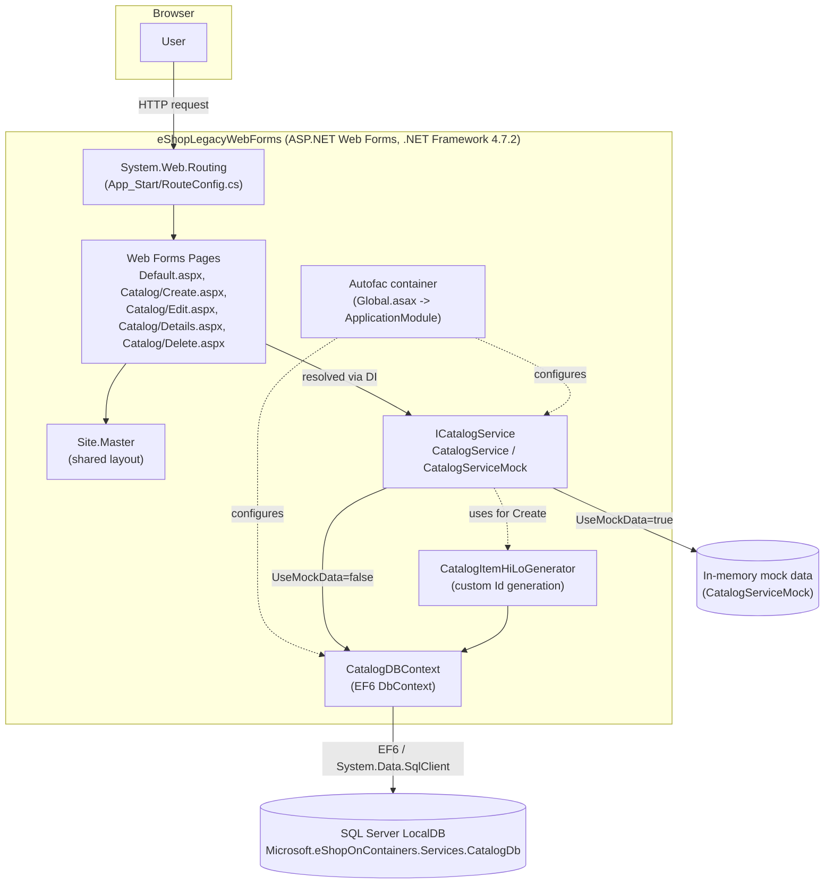

# Legacy Application Architecture

## 1. Overview

The legacy application is a single ASP.NET Web Forms project (`eShopLegacyWebForms`) with no separate API or service tier. Pages call directly into an `ICatalogService`, which uses an Entity Framework 6 `DbContext` to read and write a SQL Server LocalDB database. Dependency injection is wired once at application startup with Autofac.

### Data tables

`CatalogDBContext` maps three tables, with `CatalogItem` referencing the other two by foreign key:

| Table | Entity | Columns |
|---|---|---|
| `Catalog` | `CatalogItem` | `Id` (PK, app-assigned via HiLo), `Name`, `Description`, `Price`, `PictureFileName`, `CatalogTypeId` (FK), `CatalogBrandId` (FK), `AvailableStock`, `RestockThreshold`, `MaxStockThreshold`, `OnReorder` |
| `CatalogBrand` | `CatalogBrand` | `Id` (PK), `Brand` |
| `CatalogType` | `CatalogType` | `Id` (PK), `Type` |

## 2. Main Dependencies

From `packages.config` and framework references, the dependencies that most shape the architecture:

| Dependency | Role |
|---|---|
| `System.Web` (.UI, .Routing, .Optimization, .Hosting) | Web Forms page lifecycle, server controls, ViewState, URL routing, bundling — part of .NET Framework, not NuGet |
| `EntityFramework` 6.2.0 | ORM / data access (`CatalogDBContext`, LINQ-to-Entities, migrations/initializers) |
| `Autofac` 4.9.1 + `Autofac.Web` 4.0.0 | Dependency injection container, wired into `HttpApplication` via `IContainerProviderAccessor` |
| `log4net` 2.0.10 | Logging |
| `Microsoft.ApplicationInsights.*` | Telemetry/monitoring, hooked into the request pipeline |
| `Microsoft.AspNet.FriendlyUrls`, `Microsoft.AspNet.ScriptManager.*` | Web Forms-specific routing and script/resource management |
| `Newtonsoft.Json` 12.0.1 | JSON serialization |
| `bootstrap` / `jQuery` / `Modernizr` / `Respond` (NuGet-packaged front-end libs) | Client-side UI, served through `BundleConfig` |

A full point-by-point inventory of `System.Web` call sites and their suggested ASP.NET Core/Blazor replacements is in [dependency-inventory.md](dependency-inventory.md).

## 3. Technical Debt / Migration Blockers

- **Framework lock-in.** The app targets classic ASP.NET Web Forms on .NET Framework 4.7.2. It cannot run on modern .NET; every page, not just the data layer, needs to be rewritten rather than ported.
- **Page lifecycle coupling.** Business logic lives in code-behind `Page_Load`/button-click handlers tied to `IsPostBack` and `ViewState`. There's no clean seam between UI and application logic to lift out.
- **EF6, not EF Core.** `CatalogDBContext` uses `System.Data.Entity` (EF6) APIs (`DbModelBuilder`, `EntityTypeConfiguration<T>`, `Database.SetInitializer`), which have no direct equivalent in EF Core — the context and model configuration must be re-authored, not upgraded in place.
- **Custom Id generation.** New `CatalogItem` rows get their `Id` from `CatalogItemHiLoGenerator`, a hand-rolled HiLo sequence against the EF6 context, instead of a database identity/sequence. The modern data layer needs an equivalent strategy (or a schema change, which is out of scope for now).
- **DI tied to `HttpApplication`.** Autofac is wired through `Autofac.Integration.Web` and `IContainerProviderAccessor` in `Global.asax`, a pattern specific to classic ASP.NET; ASP.NET Core's built-in DI (or a different Autofac integration) replaces it wholesale.
- **Mock vs. real data via a boolean flag.** `UseMockData` in `Web.config` switches between `CatalogServiceMock` and `CatalogService` at container-build time. The modern app should prefer environment-based configuration/`appsettings.json` and DI registration rather than a runtime flag read with `bool.Parse`.
- **Routing via `MapPageRoute`.** URLs like `Catalog/Edit/{id}` are registered against specific `.aspx` files in `RouteConfig.cs`. Blazor's attribute routing (`@page`) replaces this, but route names/shapes should be preserved deliberately (see [routes.md](routes.md)) so links and tests don't silently break.
- **Session-based state.** `Global.asax` stashes `MachineName`/`SessionStartTime` in `Session` on every session start; any equivalent diagnostics in the modern app need a different mechanism (Blazor Server circuits aren't classic ASP.NET sessions).
- **Validation via `DataAnnotations` + Web Forms validators.** Pages mix `RequiredFieldValidator`/`RangeValidator` server controls with `DataAnnotations` on the model. Blazor's `EditForm`/`DataAnnotationsValidator` cover the model-level rules, but any validation logic living only in the `.aspx` markup needs to be re-specified explicitly.
