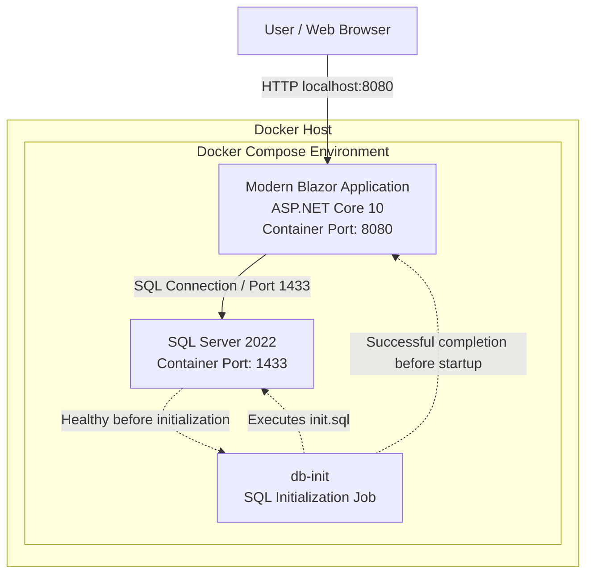

# Deployment Diagram

## 1. Overview

The modernized eShop application is deployed using Docker Compose. The deployment consists of an ASP.NET Core 10 Blazor application, a Microsoft SQL Server 2022 database, and a database initialization container.

The legacy ASP.NET Web Forms application is not included in the Docker Compose deployment.

## 2. Deployment Architecture



## 3. Deployment Components

| Component | Technology | Responsibility |
|---|---|---|
| Modern Application | ASP.NET Core 10 / Blazor | Hosts the modern eShop web application |
| Database | Microsoft SQL Server 2022 | Stores catalog data |
| Database Initialization | Docker initialization container | Executes the database initialization script |
| Docker Compose | Docker | Defines services, dependencies, environment variables, and port mappings |

## 4. Container Configuration

### Modern Application

The Modern application uses a multi-stage Docker build:

1. Build stage: .NET SDK 10.0.
2. Runtime stage: ASP.NET Core 10.0.
3. Published application: `EShop.Modern.dll`.
4. Exposed HTTP port: 8080.

The application is accessible at:

`http://localhost:8080`

### SQL Server

The database uses the official Microsoft SQL Server 2022 container image.

Port mapping:

`1433:1433`

The application connects to SQL Server using the Docker Compose service hostname `sqlserver`.

### Database Initialization

The `db-init` service executes `init.sql` after SQL Server passes its health check.

The Modern application is configured to start only after the initialization service completes successfully.

## 5. Startup Sequence

1. Docker Compose starts SQL Server.
2. SQL Server passes its health check.
3. The `db-init` container executes the SQL initialization script.
4. The initialization process completes successfully.
5. The Modern application starts and connects to the database.
6. Users access the application through port 8080.

## 6. Deployment Command

From the project root:

```bash
docker compose up --build
```

## 7. Notes and Limitations

- This diagram represents the deployment defined in `docker-compose.yml`.
- The deployment configuration uses development-oriented database credentials and is not a production security design.
- The database port is published to the host.
- No persistent SQL Server volume is explicitly defined in the provided Compose configuration.
- The diagram documents the configured architecture; successful runtime deployment must be verified separately.
- The legacy application is outside the scope of this containerized deployment.